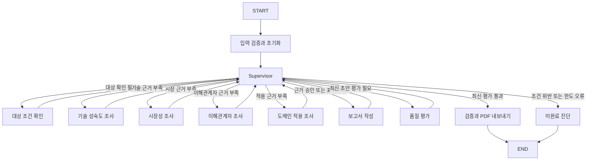

# 중립적 AI 스타트업 평가 Supervisor SDD 명세

[V2 중립적 AI 스타트업 평가 구현 역할 분담](https://chatgpt.com/space/page_930d7b5028148191828eda34d763458b)

이 명세는 AI 스타트업을 기술 성숙도, 시장성, 이해관계자, 도메인 적용의 네 관점에서 조사하고, 근거가 충분할 때 중립적 보고서를 생성하는 LangGraph 시스템의 구현 계약이다. Supervisor가 수집 상태와 근거 부족에 따라 다음 작업을 결정하며, 작성 후 품질 평가를 통과한 보고서만 최종 결과로 제공한다.

명세 버전은 1.0이며 기준일은 2026년 10월 13일이다. MUST는 필수 구현 및 인수 조건, SHOULD는 변경 사유를 기록하면 조정할 수 있는 기본 선택이다. 본 명세의 반복 횟수, 검색 설정, 출처 수, 품질 점수는 프로젝트 설계값이며 과제 원문의 지정값과 구분한다. 이 문서는 개발 기준이며 실제 구현이나 테스트의 완료를 의미하지 않는다.

구현을 시작할 때는 3절의 요구사항과 4절의 그래프를 먼저 읽고, 5절부터 11절까지의 계약을 모듈에 반영한다. 검증 담당자는 14절의 인수 시나리오를 사용한다. 12절은 기존 코드의 재사용 범위, 15절과 16절은 작업 순서와 개발 에이전트 전달 지시다. State는 재개 가능한 실행 상태, DTO는 에이전트 경계에서 검증하는 입력과 출력 데이터, receipt는 이미 수행한 작업을 확인하는 저장 기록이다.

## 1 목적과 요구사항 우선순위

최신 [Agent 과제](https://chatgpt.com/space/page_f8a34abcafb48191a6c9f173e4095725)의 Supervisor 필수 조건, 네 관점, 중립성, 보고서 최대 10페이지를 우선한다. 연결된 [RAG 실습](https://chatgpt.com/space/page_e554122247488191835b1ddf0fb58549)의 스타트업 대상 조건, 허용 도메인, RAG, 오픈소스 임베딩, 참고문헌 형식을 계승한다. 사용자는 중립적 스타트업 평가를 선택했다.

| 충돌 항목 | 적용 결정 |
| --- | --- |
| 투자 또는 보류 판단과 중립성 | 투자 추천, 순위, 우열 판정, ROI 추정, 종합 투자 점수를 생성하지 않는다. 성장 조건과 한계를 근거로 설명한다. |
| 이전 실습의 기술력 시장성 경쟁력과 최신 네 관점 | technology_maturity, market, stakeholders, domain_application을 필수 관점으로 사용한다. 경쟁사 정보는 시장성과 도메인 적용의 근거에 포함한다. |
| 보고서 5페이지와 10페이지 | 최신 과제에 따라 PDF 전체 최대 10페이지, SUMMARY 최대 반 페이지로 구현한다. |
| README의 KV cache 및 SW HW 예시 | 예시를 스타트업 주제로 바꾼다. 별도 SW HW 기술 선정은 요구하지 않는다. |
| 순차 병렬 예시와 동적 패턴 | 기존 고정 분석 경로를 Supervisor의 상태 기반 라우팅으로 대체한다. |

## 2 제품 범위와 사용 흐름

MVP는 한 실행에서 사용자가 지정한 스타트업 한 곳을 평가한다. 사용자는 기업명, 공식 홈페이지, 허용 도메인, 평가 기준일, 문서 풀을 제공한다. 시스템은 대상 조건을 확인하고 네 관점을 조사한 뒤 근거 평가, 보고서 작성, 품질 평가, PDF 내보내기를 수행한다. 여러 기업의 자동 발굴, 투자 추천, 웹 UI, 자동 제출은 MVP 범위에서 제외한다.

대상은 비상장, Seed부터 Series C까지, M&A 등 Exit이 완료되지 않은 기업이어야 한다. 판정에는 기준일과 출처를 붙인다. 기업명이나 모델의 기억만으로 대상 조건을 확정하지 않는다. 하나라도 조건 위반이 확인되면 ineligible, 위반은 없지만 확인되지 않은 조건이 남으면 unknown으로 분류한다. unknown은 eligible로 승격하지 않는다.

허용 도메인은 AgTech, Energy, Healthcare AI, Physical AI / Robotics, Semiconductor이다. 도메인을 추측해 고정하지 않고 실행 설정으로 받는다.

관점 ID 대응은 기술 성숙도 = technology_maturity, 시장성 = market, 이해관계자 = stakeholders, 도메인 적용 = domain_application이다. 이 ID를 State, 프롬프트, 산출물, trace에서 일관되게 사용한다.

| 입력 | 필수 계약 |
| --- | --- |
| company_name, official_url | 비어 있지 않은 기업명과 유효한 공식 URL |
| domain | 다섯 허용 도메인 중 하나 |
| as_of_date | YYYY-MM-DD, 실행일 이후 날짜 금지. 문서의 발행 및 사건 시점도 이 기준일과 대조 |
| corpus_manifest | 문서 식별자, 파일 경로, 원본 URL, 발행처, 발행일 또는 unknown, PDF 페이지 수, SHA-256 |
| run_config | 모델 설정, 검색 및 평가 설정, 시간과 반복 상한, corpus/index/prompt/config 버전 |

성공 실행은 report.md, report.json, report.pdf, evaluation.json, manifest.json, decisions.jsonl과 LangSmith trace 식별자를 제공한다. 미완료 실행은 diagnostics.json과 존재하는 draft만 제공하며 승인된 report.pdf를 만들지 않는다.

## 3 요구사항과 검증 연결

| ID | MUST 요구사항 | 구현 위치 | 인수 시나리오 |
| --- | --- | --- | --- |
| FR01 | Supervisor가 현재 State로 다음 노드를 선택하고 add_conditional_edges로 분기 | graph, supervisor, policy | AT01 AT02 |
| FR02 | 하위 에이전트는 Supervisor와만 통신 | 노드 래퍼, 입력 DTO | AT03 |
| FR03 | 네 관점의 근거 충분성을 승인한 뒤 writer 실행 | evidence gate, writer guard | AT04 AT17 AT18 |
| FR04 | 근거 부족 관점에 gap을 포함해 재작업 요청 | supervisor, research request | AT02 AT05 |
| FR05 | 작성 후 네 품질 항목 평가 및 미달 시 Loop | evaluator, repair policy | AT06 AT07 AT16 |
| FR06 | 기술 성숙도에 문서 RAG 적용, 전체 PDF 풀 200페이지 이하 | ingestion, retrieval | AT08 |
| FR07 | 오픈소스 임베딩 사용 및 후보 비교 기록 | retrieval config, README | AT08 |
| FR08 | 주장과 실제 출처 발췌의 연결, 편향 및 중립성 검사 | evidence store, evaluator | AT05 AT06 |
| FR09 | 중단 후 최소 State로 재개, 중복 산출물 방지 | checkpointer, artifact store | AT09 AT19 |
| FR10 | 반복 및 시간 상한으로 종료, 실패를 성공 처리하지 않음 | budgets, terminal handling | AT10 AT11 |
| FR11 | SUMMARY와 REFERENCE, 10페이지 PDF, 반 페이지 요약 | writer, renderer, export checks | AT12 |
| FR12 | 별도 branch, README, LangSmith PNG, 평가 PDF | 패키징, 제출 점검 | AT13 |

## 4 아키텍처와 책임 경계

Supervisor 패턴을 선택한다. 기업과 관점마다 정보의 부족 정도가 달라 특정 관점만 다시 조사할 수 있어야 하기 때문이다. 장점은 재조사 대상과 사유를 설명하기 쉽다는 점이고, 비용은 Supervisor 평가 호출과 순차 처리의 지연이다. MVP에서는 동시에 실행되는 하위 에이전트를 하나로 제한해 공유 State와 복구를 단순하게 유지한다.

하위 에이전트의 LLM 프롬프트에 전체 State를 전달하지 않는다. 노드 래퍼가 Supervisor의 active_task를 입력 DTO로 변환한다. 관점 에이전트는 다른 관점의 결과나 에이전트 호출 함수를 받지 않는다. 다른 관점과의 연계가 필요하면 cross_view_gap을 Supervisor에 반환한다. 보고서 작성자만 Supervisor가 승인한 네 결과를 전달받는다.



모든 대상 확인, 관점 조사, 작성, 평가 결과는 Supervisor로 돌아온다. 같은 Supervisor 노드에 고정 outgoing edge를 추가하지 않는다. 라우터는 단일 next_action을 반환하며 직접 State를 수정하지 않는다. 상태 갱신은 supervisor_node에서 수행한다. 이 연결은 LangGraph의 [조건 분기 계약](https://docs.langchain.com/oss/python/langgraph/graph-api#conditional-edges)을 따른다.

| 노드 | 입력 | 출력과 책임 |
| --- | --- | --- |
| initialize | RunInput와 설정 | 입력 검증, 식별자, 초기 State. 잘못된 입력은 graph 시작 전 거절 |
| supervisor | 제어 상태, pending_result, 근거 요약 | 결과 수용, 충분성 평가, 재작업 지시, next_action, 현재 decision 로그 |
| eligibility | 기업과 기준일 | 세 대상 조건의 판정, claim과 출처, unknown gaps |
| technology_maturity | 해당 관점 ResearchRequest | 원리, 검증 수준, 실증 조건, 한계. MUST 문서 RAG 검색 수행 |
| market | 해당 관점 ResearchRequest | 수요, 시장 정의, 수익 모델, 경쟁 환경, 수치의 범위와 기준 시점 |
| stakeholders | 해당 관점 ResearchRequest | 고객, 사용자, 팀, 파트너, 규제 주체의 이해와 도입 부담 |
| domain_application | 해당 관점 ResearchRequest | 실제 적용 사례, 배포 조건, 데이터 요구, 운영 및 도메인 한계 |
| writer | 승인된 근거 묶음, 수정 지시 | 구조화된 DraftReport, Markdown. 새 사실이나 출처 생성 금지 |
| evaluator | 최신 보고서와 인용 원문 | 형식 검사와 LLM Judge 결과, 항목별 실패 및 repair_kind |
| publish | 최신 pass 판정과 보고서 | PDF 렌더, 페이지 및 산출물 검사, 성공 manifest |
| abort | terminal_reason와 현재 ref | 실패 진단, 기존 draft 표시, 승인 PDF 없음 |

## 5 Supervisor 판단과 재작업 규칙

Supervisor는 대상 판정, 미수집 관점, 구조적 근거 검사, 의미적 충분성, 보고서와 평가의 최신성을 순서대로 확인한다. 판단 결과는 Pydantic 스키마로 검증하고 정책 코드로 허용 범위를 제한한다. LLM이 충분하다고 답해도 필수 출처, 관점, 대상 조건이 누락되면 writer로 갈 수 없다. 발행일이나 사건 시점이 as_of_date 이후인 자료는 근거 승인에서 제외하고 미래 정보를 당시 사실로 쓰지 않는다.

다음은 정상 실행의 판단 우선순위다. 전체 deadline과 graph step 한도는 새로운 업무 노드를 시작할 수 있는 hard limit이다. 조사 및 보완 횟수는 추가 작업의 허용 여부에만 적용한다. 마지막 허용 조사나 보완에서 통과한 결과는 이후 gate 및 publish로 진행할 수 있다. 실제 시스템 오류와 입력 오류는 별도 오류 계약을 따른다.

1. pending_result를 active_task와 대조하고 한 번만 수용한다.

2. ineligible 또는 회복 불가능한 오류가 있으면 abort한다. unknown 대상 조건은 허용된 횟수 안에서 eligibility에 재요청한다.

3. 미수집 또는 불충분 관점을 우선순위에 따라 선택한다. 이미 충분한 다른 관점을 호출하지 않는다.

4. 네 관점과 대상 조건이 승인되면 evidence_gate_pass를 기록한다.

5. 최신 근거로 작성한 보고서가 없으면 writer로 간다.

6. 최신 보고서에 대한 평가가 없으면 evaluator로 간다.

7. 최신 평가가 pass면 publish한다.

8. 평가가 fail이면 repair_kind에 따라 writer 또는 해당 관점 조사로 돌아간다. 수정 한도가 없으면 abort한다.

조사 대상 우선순위는 미수집 100, 필수 질문 미충족 80, 인용 불일치 70, 출처 편중 60, 평가에서 요청한 추가 검증 50으로 시작한다. 여러 gap이 있으면 가장 높은 값을 사용하고, 중요 gap 개수로 동점을 해소한다. 최종 동점은 perspective ID 문자열 정렬로 해소한다. 이 값은 재현 가능한 프로젝트 기본 정책이며 품질 점수가 아니다. 기존 순서를 index로 순회하는 구현은 금지한다.

재작업 요청에는 perspective, gap_id, 부족한 질문, 기존 evidence_ids, 제외할 중복 출처, 추가로 필요한 자료 유형, query_hints, attempt를 MUST 포함한다. 이전 검색어를 그대로 반복하지 않도록 queries_hash를 기록한다. 같은 쿼리를 재사용하는 경우에는 일시적 도구 실패 등 사유를 남긴다.

새 연구 결과를 수용하면 evidence_epoch를 증가시키고 기존 draft 평가를 무효화한다. 근거가 같아도 보고서 표현을 바꾸면 report_revision과 content_hash를 변경하고 재평가한다. 예전 pass 결과로 새 보고서를 승인하지 않는다.

새 대상 판정이나 관점 결과를 수용하면 evidence_gate_pass를 false로 재설정하고 gate_ref를 무효화한다. 충분성을 다시 승인할 때 현재 evidence_epoch, 대상 판정 hash, 네 관점 result_hash, rubric_version을 담은 GateCertificate를 저장한다. writer와 publish는 bool만 보지 않고 이 인증서의 현재성을 검증한다.

품질 실패를 수용하면 모든 finding을 하나의 immutable RepairPlan으로 저장한다. research 대상의 모든 slot을 insufficient로 표시하고 해당 gap을 추가한다. repair_cycles는 실패한 report revision당 보완 시작 시 한 번만 증가한다. 여러 관점의 재조사, 재작성, 재평가가 끝날 때까지 같은 cycle_id를 유지한다. evidence_epoch 변경으로 eval을 무효화해도 RepairPlan의 나머지 gap을 삭제하지 않는다. 계획의 research gap이 모두 해결되어야 writer로 갈 수 있다.

## 6 근거 충분성 계약

Supervisor의 작성 전 게이트는 형식 검사와 의미적 검토를 결합한다. 아래 조건이 모두 참이어야 evidence_gate_pass가 된다. 출처 개수만 맞추거나 모든 에이전트를 한 번씩 호출한 것은 충분성 조건이 아니다.

| 검사 | 통과 조건 |
| --- | --- |
| 대상과 기준일 | eligibility가 eligible이며 근거 및 사건 시점이 기준일에 부합 |
| 네 관점 | 각 관점의 필수 질문에 답한 supported claim이 최소 2개 있고 관점 상태가 sufficient |
| 관점별 출처 | 서로 다른 publisher_group의 본문 확인 출처 최소 2개, 그중 기업이 통제하지 않는 출처 최소 1개 |
| 전체 출처 | publisher_group 최소 3개. 재배포 기사와 동일 문서의 여러 chunk는 독립 출처로 계산하지 않음 |
| 사실과 인용 | 모든 supported claim이 적어도 하나의 검증된 evidence에 연결되고 발췌가 해당 주장을 지지 |
| 한계와 상충 | 관점마다 검증 한계 또는 정보 공백을 명시. 상충 자료가 발견되면 양쪽 출처와 차이의 원인을 보존 |
| RAG | 기술 성숙도 조사에서 실제 문서 검색을 수행한 retrieval receipt가 있고 적어도 하나의 PDF 근거를 사용 |
| 의미 검토 | 네 관점 각각 sufficiency verdict가 pass이고 미해결 critical gap이 없음 |

필수 질문은 기술 성숙도의 원리와 검증 수준, 시장성의 수요와 수익 또는 경쟁 조건, 이해관계자의 주요 주체와 부담, 도메인 적용의 실제 사례와 운영 조건이다. 상충 자료가 없으면 ‘상충 자료를 발견하지 못했다’고 한정한다. 부정적 자료가 없다고 긍정 결론을 만들거나 부정 자료를 꾸며내지 않는다. 필수 질문의 답을 찾지 못한 unknown만 나열해서 supported claim 기준을 충족시키지 않는다.

각 claim은 fact, inference, unknown 중 하나로 분류한다. fact에는 원문으로 확인한 주장을, inference에는 근거와 조건을 함께 제시한 추론을, unknown에는 확인하지 못한 질문과 검색 범위를 기록한다. 평가 점수와 순위처럼 기술의 우열을 암시하는 산출물은 넣지 않는다.

## 7 데이터 모델과 State

실제 타입은 Pydantic 2 모델과 TypedDict로 구현한다. 알 수 없는 필드는 거절하고 enum, 문자열 길이, 참조 무결성을 검증한다. 아래 표의 필드는 구현 계약이며 축약된 명세를 개발자가 임의로 해석하지 않도록 contracts 모듈에서 한 곳에 정의한다.

### 외부에 저장하는 산출물

| 타입 | 필수 필드와 검증 |
| --- | --- |
| Source | source_id, canonical_url 또는 원본 파일 식별자, title, publisher, publisher_group, source_type, published_at 또는 null, retrieved_at, corporate_controlled, sha256, content_ref. source_type은 company, paper, institution, news, dataset 중 하나 |
| Evidence | evidence_id, source_id, company_id, chunk_id, page_number 또는 null, quote, quote_hash, event_date 또는 null. PDF는 실제 페이지 번호, 웹은 본문 위치 식별자 보존 |
| Claim | claim_id, perspective, text, kind, evidence_ids, limitations. fact와 inference는 evidence_ids 비어 있음 금지, unknown은 정보 공백을 사실처럼 쓰지 않음 |
| ClaimSupport | claim_id, claim_hash, evidence_hashes, support_status, reason, verifier_version. support_status는 unverified, supported, partial, unsupported 중 하나 |
| Gap | gap_id, perspective 또는 eligibility 또는 report, kind, question, severity, evidence_ids, query_hints. severity는 critical 또는 warning |
| PerspectiveResult | task_id, perspective, attempt, claims, evidence_ids, answered_questions, gaps, limitations, retrieval_receipts, result_hash. answered_questions는 question_id에서 claim_id 목록으로의 사전 |
| EligibilityResult | task_id, unlisted, funding_stage, exit_status, verdict, claims, gaps, result_hash. 각 조건은 true, false, unknown |
| ResearchRequest | task_id, company_id, perspective, as_of_date, prior_result_ref, gap_ids, instructions, query_hints, excluded_source_ids, attempt, corpus_version |
| SufficiencyVerdict | perspective, structural_pass, semantic_pass, gaps, evidence_ids, claim_support_refs, reason, result_hash, rubric_version |
| DraftReport | revision, evidence_epoch, sections, claim_ids, citations, content_hash, document_ref. 각 문단의 fact 또는 inference는 claim_id와 evidence_ids를 보존 |
| EvalVerdict | report_revision, report_hash, evidence_epoch, structural_checks, criterion_scores, findings, overall_pass, repair_kind, rubric_version, judge_model, prompt_hash |
| Decision | decision_id, run_id, trace_id, step, next_action, reason, gap_ids, input_state_hash, policy_version, ts |
| ArtifactRef | relative_path, sha256, media_type, schema_version. 실행별 artifact root 내부 경로만 허용 |
| GateCertificate | evidence_epoch, eligibility_hash, perspective_hashes, rubric_version, passed, reason_ref. 현행 결과의 hash와 모두 일치해야 유효 |
| RepairPlan | cycle_id, failed_report_revision, findings, gap_ids, research_targets, rewrite_instructions. 현재 cycle의 불변 보완 계획 |
| TaskEnvelope | task_id, node, perspective 또는 null, logical_attempt, report_revision 또는 null, evidence_epoch, payload_ref, input_hash, dispatched_at. node는 그래프에 등록한 대상 확인, 관점, writer, evaluator 중 하나 |
| RetrievalReceipt | query_id, query_text, queries_hash, provider, corpus_version, index_version, filters, ranked_hits, outcome, ts. ranked_hits는 source_id, chunk_id, rank, score의 목록, outcome은 success, empty, source_inaccessible, error |

출처 메타데이터를 모르면 null로 보존하며 저자, 날짜, 페이지를 생성하지 않는다. quote는 실제 본문의 해당 구간과 일치해야 한다. 회사명과 company_id를 대조해 다른 기업 자료의 혼입을 막는다. 검색 결과 snippet만 확보한 자료는 verified evidence가 아니다.

supported claim은 fact 또는 inference이면서 최신 ClaimSupport의 support_status가 supported인 주장이다. worker의 자기 판정은 채택하지 않는다. Supervisor의 근거 검증 단계가 실제 발췌와 비교한 ClaimSupport를 저장하고 SufficiencyVerdict가 그 참조를 포함한다. 각 필수 question_id에 적어도 하나의 supported claim이 연결되어야 답한 것으로 인정한다. 관점별 supported claim 2개 조건도 별도로 만족해야 한다. answered_question_ids는 이 검증된 사전의 키 집합으로 계산한다.

Gap.kind는 missing_question, missing_evidence, citation_mismatch, source_bias, conflicting_evidence, eligibility_unknown, report_expression, report_coverage 중 하나다. answered_questions와 answered_question_ids는 아래 고정 질문 ID를 사용한다. 표시 문구는 변경할 수 있지만 ID를 임의 생성하지 않는다.

| 관점 | 필수 질문 ID | 질문 |
| --- | --- | --- |
| technology_maturity | tech.principle, tech.validation | 어떤 원리로 문제를 해결하는가, 어떤 조건에서 어느 수준까지 검증되었는가 |
| market | market.demand, market.economics | 누가 어떤 수요를 갖는가, 수익 모델과 경쟁 또는 시장 진입 조건은 무엇인가 |
| stakeholders | stakeholders.actors, stakeholders.burdens | 주요 이해관계자는 누구인가, 각 주체의 기대와 부담은 무엇인가 |
| domain_application | domain.cases, domain.conditions | 어떤 적용 사례가 확인되는가, 데이터와 운영 및 도입 조건은 무엇인가 |

DraftReport.sections는 고정 section_id, title, paragraphs의 순서 있는 목록이다. paragraph는 paragraph_id, text, kind, claim_ids, evidence_ids를 가진다. kind는 fact, inference, unknown, connective이며 connective는 새 사실을 포함할 수 없다. citations는 source_id와 evidence_id 및 paragraph_id를 연결하는 목록이다. 주장 ID는 승인 근거 묶음의 ID만 사용한다. content_hash는 sections, claim_ids, citations, evidence_epoch를 canonical JSON으로 직렬화한 SHA-256이며 자기 hash, 파일 ref와 생성 시각은 hash 입력에서 제외한다.

### 체크포인트에 저장하는 State

| 구분 | 필드 | 타입과 책임 |
| --- | --- | --- |
| 페이로드 | input_ref, config_ref, company_ref | ArtifactRef, 입력과 실행 설정의 고정 snapshot |
| 페이로드 | eligibility_ref | ArtifactRef 또는 null, 대상 판정 원문 참조 |
| 페이로드 | perspectives | 네 perspective 키의 PerspectiveSlot 사전 |
| 페이로드 | draft_report_ref, eval_ref, final_manifest_ref | ArtifactRef 또는 null, 최신 산출물 참조 |
| 페이로드 | gate_ref, repair_plan_ref | GateCertificate와 RepairPlan의 ArtifactRef 또는 null |
| 제어 | run_id, trace_id, thread_id | UUID 문자열, 산출물과 외부 trace 및 checkpoint 연결 |
| 제어 | status, terminal_reason | status는 running, completed, incomplete, failed. terminal_reason은 종료 계약의 enum 또는 null |
| 제어 | eligibility_status, evidence_gate_pass | pending, eligible, ineligible, unknown과 bool |
| 제어 | active_task, pending_result | TaskEnvelope 또는 null, ResultEnvelope 또는 null. 한 번에 하나의 task만 활성화 |
| 제어 | accepted_task_ids | 수용한 task ID의 중복 없는 목록. max_graph_steps 이하로 제한하여 replay 수용 방지 |
| 제어 | next_action, last_decision_id | 허용 노드 enum, 외부 결정 로그 식별자 |
| 제어 | step_count, research_attempts, eligibility_attempts | 0 이상 int와 관점별 int 사전, 실행 상한 관리 |
| 제어 | repair_cycles, report_revision, evidence_epoch | 0 이상 int. 품질 실패 후 재작성 또는 재조사를 시작할 때 repair_cycles 증가 |
| 제어 | active_repair_cycle_id, resolved_gap_ids | 현재 보완 cycle 식별자 또는 null, 현재 cycle에서 해결한 gap ID 집합 |
| 제어 | node_status, transient_retries | 노드별 최소 상태와 active_task의 기술 재시도 횟수 |
| 제어 | last_error | code, node, retriable, message를 가진 짧은 ErrorSummary 또는 null |
| 제어 | started_at, deadline_at, versions | UTC 시각, schema/corpus/index/config/prompt/policy/model 버전 및 hash |

PerspectiveSlot은 status, latest_result_ref, result_hash, sufficiency_ref, gap_ids, source_count, publisher_group_count, answered_question_ids, attempt를 담는다. status는 pending, insufficient, sufficient, failed이다. 원문이나 보고서 본문을 State에 넣지 않는다. gap 상세와 긴 판단 사유는 외부 artifact에 두고 ID와 판정만 저장한다.

ResultEnvelope은 task_id, outcome, result_ref, error를 가진다. outcome은 success, empty, transient_error, permanent_error이다. worker 본체는 pending_result만 반환하며 Supervisor가 perspectives와 control을 갱신한다. 공통 node wrapper가 논리적 step_count와 최소 node_status patch를 추가한다. stale task_id 또는 이미 수용한 결과는 재적용하지 않고 무결성 오류 또는 중복 receipt로 처리한다.

### State 설계의 일곱 근거

| 과제 항목 | 설계 결정 |
| --- | --- |
| 제어와 페이로드 분리 | routing flag, counter, task와 산출물 ref를 구분. 검색 본문과 생성 문서는 외부 저장 |
| 관측성 위치 | Decision 전체는 decisions.jsonl과 LangSmith 이벤트, State에는 last_decision_id만 유지 |
| 지속성 비용 | 직렬화 State 최대 32 KiB. 최신 slot만 유지하고 과거 결과는 artifact로 저장. 초과 시 요약 없이 STATE_TOO_LARGE 오류 |
| 상관 | run_id를 artifact 디렉터리와 이벤트에, trace_id를 LangSmith root run과 연결. thread_id는 checkpoint 식별자 |
| 재개와 복구 | SQLite checkpointer, active_task와 pending receipt, 누적 counter 및 버전 유지. corpus/config가 바뀌면 기존 run 재개 금지 |
| 동시 처리 | MVP 하위 작업 하나씩 실행. additive reducer를 사용하지 않으며 사전 전체 복사 후 갱신. 병렬 관점 결과 쓰기는 금지 |
| 종료 보장 | 조사 횟수, 품질 수정, node step, 전체 deadline과 도구 timeout으로 유한 종료 |

State 필드의 기본 갱신은 이전 값을 덮어쓴다. 따라서 사전의 일부 키만 반환해 다른 관점을 잃는 구현은 금지한다. 병렬화를 도입하는 변경은 keyed reducer와 충돌 정책을 별도 명세한 뒤 진행한다. [LangGraph reducer 문서](https://docs.langchain.com/oss/python/langgraph/graph-api#reducers)는 기본 overwrite와 명시적 merge의 차이를 설명한다.

## 8 RAG와 검색 계약

기존 기업 및 시장 검색 어댑터의 인터페이스를 보존하면서 임베딩을 오픈소스로 변경한다. 초기 데이터는 현재 저장소에 있는 Physical AI / Robotics 자료를 사용한다. 다섯 도메인 enum을 지원하더라도 corpus가 준비되지 않은 도메인은 CORPUS_DOMAIN_UNAVAILABLE로 거절한다. 기존 자료로 다른 도메인까지 검증했다고 표시하지 않는다.

| 단계 | MUST 계약과 기본 설정 |
| --- | --- |
| 문서 수집 | PDF의 실제 전체 페이지 합계 최대 200. 201페이지 이상, 암호화 또는 파싱 실패는 색인 전에 실패. 동일 hash 파일은 중복 제외하고 결과 manifest 저장 |
| 정규화 | page, source_id, publisher_group, company_id, domain, 언어, 발행일 보존. 추출 텍스트와 원본 hash 연결 |
| 청킹 | 기본 400 tokenizer tokens, overlap 60. 페이지 경계를 보존하고 모델 입력 한도를 넘기지 않음 |
| 임베딩 | 기본 BAAI/bge-m3의 dense embedding, 모델 revision 고정, 정규화 방식 기록 |
| 색인 | Qdrant 새 collection 생성. corpus와 embedding revision 및 dimension을 collection manifest에 저장. 기존 512차원 OpenAI 색인 혼용 금지 |
| 검색 | 관점별 질의 최대 3개, query별 top_k=5, 회사와 도메인 filter, source/chunk 중복 제거. 질의와 rank 및 document_id receipt 저장 |
| 외부 검색 | 기존 웹 검색 어댑터를 사용. 도구 제공자를 교체할 수 있도록 SearchProvider 인터페이스로 감쌈 |
| 본문 확보 | 실제 페이지 또는 PDF 발췌를 확보한 결과만 Evidence 생성. 접근 실패와 무결과를 구별 |

BAAI/bge-m3는 다국어 문서와 긴 문서 입력을 지원하므로 한국어와 영어 PDF를 함께 사용하는 기본 모델로 선택한다. [공식 모델 카드](https://huggingface.co/BAAI/bge-m3)의 지원 범위를 근거로 한 설계 선택이며 검색 성능 우위를 측정했다고 주장하지 않는다. 비교 후보는 [intfloat/multilingual-e5-base](https://huggingface.co/intfloat/multilingual-e5-base)이다. 후보 비교에서는 동일 corpus와 400-token 청크를 사용하고 E5의 query/passage prefix 및 입력 한도를 준수한다.

공통 문서 검색 어댑터에 대해 사람이 정답 문서를 붙인 20개 질의를 준비한다. 네 관점 각 5개, 한국어와 영어 각 10개로 구성한다. 관점 에이전트의 PDF RAG 의무는 기술 성숙도에 적용하고 검색 어댑터의 평가셋은 네 관점의 질의를 포함한다. query별 관련 source 또는 document ID를 라벨링하고 Hit Rate@5와 MRR@5, 색인 시간, 질의 p50/p95, peak memory를 측정한다. Hit Rate@5는 top 5에 관련 문서가 하나 이상인 질의 비율, MRR@5는 첫 관련 문서 순위의 역수 평균이며 없으면 0이다. 전체 20개 평균과 관점별 5개 평균을 함께 기록한다. MVP 제출 목표는 전체 Hit Rate@5 0.80 이상, MRR@5 0.60 이상이다. 목표는 프로젝트 설계값이다. 실패하면 실제 수치와 한계를 기록하고 청킹 또는 질의를 수정한 후 같은 평가셋으로 비교한다.

오픈소스 임베딩 후보 비교와 최종 선택 이유를 README에 MUST 기록한다. bge-m3를 실행할 수 없는 장비에서는 E5로 변경할 수 있지만 설정과 색인을 함께 다시 생성해야 하며 모델을 조용히 대체하지 않는다. CSV 기업 조회는 대상 탐색 보조이며 PDF RAG 사용 증빙을 대체하지 않는다.

## 9 품질 평가와 보고서 계약

평가 노드는 deterministic 형식 검사와 LLM Judge를 결합한 Hybrid 방식이다. 형식 검사 통과는 내용 품질 통과를 의미하지 않는다. Judge에는 보고서 문단, 연결된 claim, 원문 발췌, 출처 그룹, 기준일을 함께 전달한다. 보고서만 보고 self-score하게 하지 않는다. 작성 프롬프트와 평가 프롬프트는 분리한다.

| 항목 | 형식 검사 | Judge의 내용 평가 |
| --- | --- | --- |
| Groundedness | 모든 fact와 inference의 evidence ID가 실제 존재하고 본문 인용과 참조가 연결 | 발췌가 주장을 지지하는지, 추론의 조건과 시점이 과장되지 않았는지 |
| 중립성 | 추천, 투자 결정, 랭킹, 점수 비교 구조의 생성 여부 검사 | 문맥상 우열 암시, 과장, 특정 기술 또는 기업의 권유 여부 |
| 편향 통제 | 출처 수와 publisher_group, corporate_controlled, 한계 필드 확인 | 기업 홍보자료 편중, 유리한 자료만 인용, 상충 근거 누락 여부 |
| 관점 커버리지 | 네 필수 section과 필수 질문 존재 | 제목만 있고 내용이 없지 않은지, 각 관점의 질문을 실제로 답하는지 |

Judge 점수는 항목별 0부터 4까지다. 0은 평가 불가 또는 치명적 위반, 1은 주요 위반, 2는 수정 필요, 3은 기준 충족, 4는 기준을 충분히 충족이다. overall_pass는 모든 형식 검사가 통과하고 네 항목 모두 3 이상이며 critical finding이 없을 때만 true이다. 평균 점수로 한 항목의 실패를 상쇄하지 않는다. schema 오류, timeout, Judge 예외는 pass가 아니다.

EvalFinding은 criterion, severity, section_id, claim_id 또는 null, evidence_ids, reason, repair_kind, target_perspective를 반환한다. repair_kind는 rewrite, research, none이다. 근거 추가나 관점 보완이 필요하면 research, 표현·구성만 문제이면 rewrite이다. 여러 문제가 있으면 research를 먼저 수행한다. 연구가 바뀌면 모든 최신 근거로 다시 작성하고 다시 평가한다.

보고서 순서는 SUMMARY, 기업 및 평가 범위, 기술 성숙도, 시장성, 이해관계자, 도메인 적용, 한계와 추가 확인 사항, REFERENCE로 고정한다. 첫 section은 SUMMARY, 마지막은 REFERENCE다. 요약은 분석 내용의 핵심 결과와 조건을 서술하며 소개 장표로 대체하지 않는다.

REFERENCE는 본문에서 실제로 인용한 source_id의 집합과 정확히 일치해야 한다. 기관 보고서는 기관과 연도 및 제목과 URL, 논문은 확인된 저자와 연도 및 제목과 학술지 정보, 웹은 확인된 작성자 또는 기관과 날짜 및 제목과 URL을 표기한다. 알 수 없는 발행일은 ‘발행일 미상’으로 표시한다. 없는 권호나 페이지를 채우지 않는다.

PDF는 A4, 한국어 글꼴 내장, 전체 10페이지 이하, SUMMARY 반 페이지 이하로 렌더한다. 페이지 수를 맞추려고 글자를 극단적으로 줄이거나 본문을 자르지 않는다. 평가 완료 문서의 내용을 바꾸면 재평가해야 한다. publish는 순수 레이아웃 렌더만 수행하며 PDF text와 평가된 문단·인용의 일치 여부를 검사한다. 레이아웃 한도 실패는 PDF_LAYOUT_FAILED로 종료하고 draft와 진단을 보존한다.

## 10 종료와 오류 처리

아래는 MVP 기본 상한이다. 구현 시 config에 노출하고 실제 실행 manifest에 기록한다. 상한을 변경해도 근거 게이트와 품질 기준을 완화할 수 없다.

| 설정 | 기본값 | 정의 |
| --- | --- | --- |
| max_research_attempts_per_view | 3 | 최초 조사 1회와 추가 조사 최대 2회. empty와 기술 실패로 끝난 dispatch도 포함 |
| max_eligibility_attempts | 3 | 최초 확인과 재확인 포함 |
| max_quality_repairs | 2 | 첫 평가 이후 보완 cycle 최대 2회. 따라서 품질 평가 최대 3회 |
| max_graph_steps | 60 | initialize 이후 각 논리적 node 실행 횟수. 재개 시 누적 유지 |
| recursion_limit | 100 | LangGraph superstep 비상 상한, 최상위 invoke config에 설정 |
| run_deadline_seconds | 900 | 최초 시작부터 15분. 재개 시 deadline 연장 금지 |
| tool_timeout_seconds | 30 | 개별 검색, fetch, 저장소 호출의 최대 시간 |
| llm_timeout_seconds | 60 | 개별 생성 또는 Judge 호출 최대 시간 |
| max_transient_retries | 2 | active_task 내 최초 호출 후 기술 재시도 최대 2회 |
| max_sources_per_run | 40 | 검증 source 최대 40개. 40개로 충분하면 계속 진행, 41번째 신규 source가 필요하면 incomplete 종료 |

타임아웃과 재시도는 전체 deadline의 남은 시간 안에서만 허용한다. 각 노드의 입출력 receipt와 step_count 갱신을 같은 checkpoint update로 남긴다. 내부 기술 재시도는 별도 카운터를 사용한다. recursion_limit은 조사 횟수나 근거 충분성 판단을 대신하지 않는다. 이를 초과하면 상위 runner가 GraphRecursionError를 받아 diagnostics를 기록한다. [Graph loop 문서](https://docs.langchain.com/oss/python/langgraph/use-graph-api)는 superstep 상한과 업무 종료 조건을 구분한다.

| 상황 | 동작과 최종 판정 |
| --- | --- |
| 일시적 네트워크 오류, 429, 5xx | retry-after를 존중하고 기본 1초와 2초 backoff로 최대 2회 재시도. deadline 초과 금지 |
| provider API 401 또는 403, 설정 오류, 색인 불일치 | 같은 설정으로 재시도하지 않고 failed, CONFIG_OR_AUTH_ERROR 또는 INDEX_MISMATCH |
| 개별 출처의 403 또는 paywall | SOURCE_INACCESSIBLE receipt. 현재 조사에서 대체 출처를 시도하며 이 자료를 verified evidence로 사용하지 않음 |
| 검색 결과 없음 | error와 구분해 empty receipt. gap을 생성하고 관점별 남은 횟수 안에서 질의 변경 |
| LLM JSON 또는 DTO 형식 오류 | 동일 task 안에서 구조화 재요청 최대 1회. 추가 생성은 공통 기술 재시도 상한에도 포함. 계속 실패하면 failed, MODEL_OUTPUT_INVALID |
| 대상 위반 | incomplete, INELIGIBLE_TARGET. 대상 조건 진단과 출처만 제공 |
| 대상 조건 미확인 | 한도 내 재확인 후 incomplete, ELIGIBILITY_UNKNOWN |
| 특정 관점 3회 이후도 근거 부족 | incomplete, INSUFFICIENT_EVIDENCE. 해당 gap을 보존하고 writer 호출 금지 |
| 품질 보완 2회 후 미달 | incomplete, QUALITY_EXHAUSTED. draft와 마지막 평가 보존 |
| step, 시간, source 상한 소진 | incomplete, BUDGET_EXHAUSTED. 상한에 도달한 이유와 미해결 작업 기록 |
| 참조 파일 유실 또는 hash 불일치 | failed, ARTIFACT_INTEGRITY_ERROR. 임의 재생성하거나 pass 유지 금지 |
| PDF 렌더 또는 페이지 한도 오류 | failed, PDF_LAYOUT_FAILED. draft 보존, 승인 PDF 없음 |
| KeyboardInterrupt | 가장 최근 checkpoint 보존. runner가 interrupted 진단을 남기고 비정상 종료 |

completed의 필요충분조건은 eligible, 최신 네 관점 evidence gate pass, 최신 draft에 대한 품질 pass, PDF 검증 pass, manifest commit이다. timeout이나 Judge 장애를 통과로 해석하지 않는다. 미완료 진단은 실행 사실과 gap만 담고 최종 중립적 평가 보고서로 이름 붙이지 않는다.

## 11 복구와 관측성

SQLite checkpointer를 사용하는 로컬 실행을 기준으로 한다. langgraph-checkpoint-sqlite를 의존성으로 추가하고 thread_id를 config.configurable에 전달한다. [Checkpointer 문서](https://docs.langchain.com/oss/python/langgraph/checkpointers)와 [Persistence 문서](https://docs.langchain.com/oss/python/langgraph/persistence)를 기준으로 메모리 saver를 재시작 복구 장치로 사용하지 않는다.

실행 디렉터리는 outputs/{run_id}/로 고정한다. task_id는 run_id, node, perspective, 논리적 attempt를 조합한 안정적인 값이다. report key는 run_id와 report_revision이다. worker 출력과 publish receipt를 저장한 뒤 checkpoint가 완료되기 전에 중단될 수 있으므로 같은 task를 다시 실행하면 유효한 receipt와 hash를 먼저 확인한다. 존재하는 결과가 입력 hash와 일치하면 재사용한다.

Supervisor는 dispatch 전에 해당 attempt 또는 report_revision을 예약하고 TaskEnvelope을 같은 checkpoint update로 저장한다. worker replay는 같은 task_id를 재사용하며 조사 횟수를 증가시키지 않는다. 결과 수용은 slot 교체, gate 및 eval 무효화, active_task와 pending_result 초기화, accepted receipt 식별자 기록을 한 번의 update로 반영한다. step_count는 성공적으로 commit된 논리적 node 실행당 한 번만 증가한다. 새 Supervisor 결정은 새로운 step이며 동일 task replay는 동일 논리적 step이다. abort finalizer는 hard limit 이후에도 진단 저장만 수행할 수 있다.

파일은 임시 파일 작성, flush, 원자적 rename 순서로 저장한다. checkpoint에 참조를 기록하기 전에 실제 파일이 있어야 한다. PDF는 먼저 staging/report-{revision}.pdf에 렌더한다. publish는 검증된 PDF와 평가 hash를 연결한 completed manifest를 마지막에 commit하며 동일 report key가 이미 완료되면 검증 후 그대로 반환한다. 산출물 조회는 completed manifest가 승인한 파일만 최종 report.pdf로 제공한다. staging 파일의 존재를 성공으로 해석하지 않는다. 외부 LLM이나 검색 호출은 중복될 수 있다. 이 설계는 결과의 멱등성을 요구하며 외부 서비스 호출의 exactly-once를 보장하지 않는다. 여러 부수 효과를 가진 노드는 필요하면 checkpointed task로 분리한다. [Functional API 문서](https://docs.langchain.com/oss/python/langgraph/functional-api)의 재실행 조건을 따른다.

재개할 때 schema, corpus hash, index revision, config hash, prompt hash, policy version을 비교한다. 변경되면 RESUME_VERSION_MISMATCH로 거절하고 새 run을 시작한다. 과거 completed와 incomplete 실행을 동일 run_id로 다시 시작하지 않는다. 재현 검증에서는 고정 corpus와 stub 응답을 사용하고, live LLM 결과가 문장 단위로 완전히 같을 것이라고 요구하지 않는다.

LangSmith root trace에는 run_id, spec_version, corpus/index/config hash, model 정보를 metadata로 기록한다. node span에는 task_id, perspective, attempt, duration, outcome, gap_ids를 기록한다. Supervisor는 next_action과 reason, gate verdict와 증거 ID를 trace event와 decisions.jsonl에 저장한다. 키, 토큰, 전체 원문을 로그에 기록하지 않는다.

제출용 trace는 정상 종료 경로뿐 아니라 동일 관점 재조사와 평가 실패 후 보완 경로를 MUST 포함한다. mock 기반 테스트 trace는 mock임을 표시한다. 최종 제출에는 실제 모델과 실제 RAG를 사용한 성공 실행의 LangSmith 캡처도 필요하다. 긴 trace는 tracing-1.png, tracing-2.png처럼 순서가 드러나는 이름으로 저장한다.

## 12 기존 저장소 변경 경계

대상 저장소는 [SKALA BlackRubberShoes gicheol](https://github.com/SKALA-BlackRubberShoes/gicheol)이다. main에서 확인한 기존 구조는 기업 및 경쟁사 선택, 기술·시장·경쟁 병렬 분석, 투자 판단, 추천일 때 보고서 생성이다. 새로운 Supervisor 실행 경로는 별도 branch와 모듈에서 구현한다. 기존 CLI를 유지하고 새로운 명령을 추가하는 방식으로 이전 실습 실행과 구분한다.

| 기존 파일 | 변경 또는 재사용 계약 |
| --- | --- |
| main/graph/workflow.py, state.py, nodes.py | 기존 흐름은 참고. 새로운 supervisor_workflow.py, supervisor_state.py, supervisor_nodes.py로 네 관점과 상태 기반 라우팅 구현 |
| main/rag/embeddings.py | EmbeddingProvider 인터페이스와 오픈소스 어댑터 추가. 기존 OpenAI embedding과 새 색인 혼용 방지 |
| main/rag/company/baseRAG.py | CSV 기업 조회와 검색 API 재사용. 조회한 기업 정보도 원본 및 기준일 확인 대상으로 처리 |
| main/rag/market/marketRAG.py | 시장 PDF 검색 API 재사용. 신규 오픈소스 collection와 도메인 metadata 필터 연결 |
| main/rag/company_pdf/retriever.py | 현재 로컬 코사인 색인과 두 역할 query pack을 네 관점으로 확장하거나 새 Qdrant 어댑터로 교체. 현재 제한된 기업 corpus를 전체 지원처럼 노출하지 않음 |
| main/agents/common/evidence.py | ID, 회사 일치, 중복과 길이 검사 재사용. 실제 발췌 검증과 publisher_group 추가 |
| main/agents/report/schemas.py, agent.py | 기존 투자 및 추천 gating을 새 경로에서 사용하지 않음. 중립적 DraftReport schema와 builder 구현 |
| main/agents/report/renderers.py | 저수준 Markdown과 PDF 렌더 재사용. 새 경로만 max_pages=10으로 호출하고 SUMMARY 반 페이지와 한글 글꼴 검증 유지 |

현재 기존 embedding은 OpenAI의 512차원 설정이고 시장 검색은 Qdrant, 기업 PDF 검색은 로컬 색인이다. 새 명세의 bge-m3 dense 색인을 별도 구축해야 한다. 신규 색인 생성은 기존 collection을 삭제하거나 덮어쓰지 않는다. 기존 버전 고정을 우선하되 실제 설치 가능성을 확인한 잠금 파일을 제출한다.

권장 추가 파일 구조는 다음과 같다. 디렉터리 이름은 기존 저장소 관례에 맞게 조정할 수 있지만 조정, 조사, 평가, 저장 계층의 책임은 분리해야 한다.

```text
specs/sdd-spec.md
main/graph/supervisor_workflow.py
main/graph/supervisor_state.py
main/graph/supervisor_nodes.py
main/agents/supervisor/contracts.py
main/agents/supervisor/policy.py
main/agents/supervisor/agent.py
main/agents/perspectives/technology.py
main/agents/perspectives/market.py
main/agents/perspectives/stakeholders.py
main/agents/perspectives/domain.py
main/agents/quality/evaluator.py
main/agents/report/neutral_builder.py
main/storage/artifacts.py
main/storage/checkpoints.py
main/prompts/supervisor/
configs/neutral-evaluation.yaml
tests/unit/
tests/integration/
tests/acceptance/
tests/fixtures/
```

## 13 실행 인터페이스와 설정

새 실행 인터페이스는 다음을 MUST 지원한다. 명령은 구현 목표이며 현재 저장소에서 이미 실행 가능하다는 의미가 아니다.

```bash
python -m main.neutral_eval validate --config configs/neutral-evaluation.yaml
python -m main.neutral_eval ingest --config configs/neutral-evaluation.yaml
python -m main.neutral_eval run --input inputs/company.json --config configs/neutral-evaluation.yaml
python -m main.neutral_eval resume --run-id <run_id>
python -m main.neutral_eval evaluate-retrieval --dataset tests/fixtures/retrieval-gold.json
```

validate는 환경변수, 모델 설정, PDF 페이지 수, 도메인 corpus, 글꼴, SQLite와 Qdrant 접근 및 manifest 일치를 확인한다. run은 입력 validation 실패 시 exit 2, 성공 시 exit 0, incomplete 시 exit 3, 시스템 failed 시 exit 1을 반환한다. 비정상 종료 후 resume는 기존 저장 설정을 읽고 재개한다. 실행 중 모델 설정을 임의 교체하지 않는다.

| 설정 영역 | 계약 |
| --- | --- |
| 런타임 | 기존 Python 3.11 이상, LangGraph와 LangChain 1.x, Pydantic 2.x 호환성 유지. lockfile로 실제 버전 고정 |
| 생성과 조정 모델 | SUPERVISOR_MODEL, RESEARCH_MODEL, REPORT_MODEL을 실행 전에 확정. 기존 START_AGENT_MODEL과 adapter를 초기값으로 재사용 가능 |
| 품질 모델 | JUDGE_MODEL 필수 설정. 동일 모델을 써도 생성과 별도 프롬프트 및 입력 사용. 실제 model ID를 manifest와 README에 기록 |
| 검색과 임베딩 | SearchProvider, QDRANT_URL, 새 collection, EMBEDDING_MODEL, model revision과 차원 명시 |
| 인증과 로그 | OPENAI_API_KEY 및 실제 검색 provider 자격, LangSmith tracing 설정. .env.example에는 이름과 비밀이 아닌 예시만 포함 |
| 출력 | REPORT_FONT_PATH, artifact root, SQLite 경로. 설정의 상대 경로는 저장소 루트 기준 |

환경변수와 YAML의 같은 값을 동시에 정의하면 명시적 CLI override, 환경변수, YAML 순으로 우선한다. 적용된 비밀이 아닌 설정 전체를 config snapshot으로 저장한다. 필수 모델 이름이나 font가 없으면 실행 전 실패시키며 추측한 기본값으로 진행하지 않는다.

## 14 인수 시나리오

아래 시나리오는 구현 완료 조건이다. 관점별 출력과 도구 오류를 fixture로 제어해 정책을 결정론적으로 검사한다. 별도 live smoke 실행으로 실제 RAG와 모델, LangSmith, PDF 생성이 연결되는지 확인한다.

| ID | Given 및 When | Then |
| --- | --- | --- |
| AT01 | 동일 기업에 대해 시장성만 부족한 State와 기술만 부족한 State를 각각 입력 | next_action이 각각 market과 technology_maturity로 달라진다. 고정 순서로 호출하지 않는다. |
| AT02 | 기술·이해관계자·도메인은 sufficient, 시장성은 독립 출처 부족 | 시장성만 재호출하고 세 기존 결과 hash는 유지. 구체적 gap 지시와 reason이 trace에 남는다. |
| AT03 | 기술 조사 fixture가 다른 agent에 직접 요청하려 함 | wrapper에 해당 호출 경로가 없고 cross_view_gap만 반환. 모든 하위 결과의 다음 노드는 supervisor다. |
| AT04 | 네 관점 중 하나가 insufficient 또는 eligibility unknown | writer 호출 0회. 조사 상한 도달 시 incomplete로 종료하고 승인 보고서 없음. |
| AT05 | 같은 홍보문 재배포 두 URL 또는 관련 없는 발췌만 수집 | 독립 출처 두 개로 계산하지 않음. citation ID가 유효해도 의미적 근거 검사는 fail. |
| AT06 | 충분한 근거로 만든 보고서에 추천 또는 우열 문구가 포함 | 중립성 fail, rewrite로 돌아간 뒤 재평가. 추가 검색이 필요 없으면 research 호출 없음. |
| AT07 | 평가가 도메인 적용의 핵심 주장에 근거 부족을 발견 | 해당 관점 조사 후 evidence_epoch 증가, 이전 pass 무효화, 새 보고서 작성과 평가가 실행됨. |
| AT08 | PDF 201페이지 또는 다른 embedding revision의 collection을 제공 | 색인 또는 run 시작 전 실패. 200페이지 이하 fixture에서는 기술 RAG receipt와 PDF 인용이 생성됨. |
| AT09 | worker 결과 저장 직후 또는 PDF 저장 직후 checkpoint 이전에 중단 | resume가 receipt를 검증해 중복 result와 승인 PDF를 만들지 않음. 완료된 다른 관점 재호출 없음. |
| AT10 | 빈 검색 결과가 계속되거나 Judge가 연속 fail | 조사 최대 3회 또는 품질 평가 최대 3회 후 종료. INSUFFICIENT_EVIDENCE 또는 QUALITY_EXHAUSTED, completed 금지. |
| AT11 | 429 이후 정상 응답, 401, deadline 초과를 각각 주입 | 429는 지정 횟수 내 재시도, 401은 반복 없이 failed, deadline은 bounded incomplete. |
| AT12 | 네 관점과 대상 조건 및 최신 품질 평가가 pass | 실제 PDF 생성, 전체 10페이지 이하, SUMMARY 반 페이지 이하, 한글 정상 표시, 인용 source 집합과 REFERENCE 집합 일치. |
| AT13 | 실제 성공 및 재조사·품질 보완 경로를 실행 | Git branch 링크, README, LangSmith PNG, 평가 PDF가 존재하고 manifest에서 같은 run과 report revision으로 추적 가능. |
| AT14 | 연구 결과 또는 보고서 content_hash를 수정한 뒤 과거 eval pass를 제공 | publish 거절. 최신 hash와 evidence_epoch 및 revision이 일치하는 평가만 승인. |
| AT15 | resume의 corpus 또는 prompt hash가 최초 실행과 달라짐 | RESUME_VERSION_MISMATCH로 거절. 기존 결과를 변경된 설정의 결과로 제공하지 않음. |
| AT16 | 하나의 품질 실패에 시장성과 도메인 적용 두 research finding이 있음 | 하나의 repair cycle에서 두 관점을 보완. 첫 결과 수용으로 eval이 무효화돼도 나머지 gap은 유지되며 repair_cycles는 1만 증가. |
| AT17 | gate 승인 후 대상 또는 관점 결과 hash를 변경 | gate invalid, writer와 publish 거절. 새로운 GateCertificate가 승인된 뒤만 진행. |
| AT18 | 세 번째 조사 또는 두 번째 품질 보완에서 기준을 충족 | 횟수가 상한과 같아도 추가 조사 없이 gate와 publish 진행. 충분하지 않으면 다음 작업을 거절하고 incomplete. |
| AT19 | PDF staging 완료 후 manifest commit 직전 또는 직후 중단 | 직전에는 최종 PDF 미제공, resume에서 검증 및 commit. 직후에는 기존 manifest를 수용해 중복 publish 없음. |

근거 의미 평가 fixture에는 실제 excerpt로 지지되는 주장, 부분 지지, 시점 불일치, 수치의 단위 누락, 관계없는 출처, 기업 홍보 편중 사례를 포함한다. AT12의 PDF 검증은 페이지 수와 텍스트 검사 및 실제 시각 확인을 함께 수행한다. 모델의 Judge 점수만으로 전체 인수 테스트를 통과시키지 않는다.

## 15 SDD 구현 순서와 완료 조건

SDD 개발은 요구사항, 계약, 구현, 인수 테스트의 순서로 진행한다. 요구를 바꾸는 경우 해당 FR과 AT, State 버전과 본 명세를 함께 수정한다. 개발 에이전트는 명세에 없는 투자 판단이나 UI를 추가하지 않는다.

| 단계 | 작업 | 완료 조건 |
| --- | --- | --- |
| 1 | contracts와 설정 및 terminal reason 정의 | 입력과 DTO 스키마 검사, 버전 및 상한의 단일 설정 완료 |
| 2 | RAG 어댑터와 오픈소스 색인 | 페이지 제한, 모델 비교, 실제 retrieval receipt 및 근거 참조 구현 |
| 3 | Supervisor 정책과 네 관점 | AT01부터 AT05, 근거 게이트와 통신 경계 검증 |
| 4 | 중립 보고서와 Hybrid 평가 | AT06 AT07 AT12 AT14, 최신성 및 수정 Loop 검증 |
| 5 | 영속 복구와 오류 및 trace | AT09부터 AT11과 AT15, deadline 및 로그 상관 검증 |
| 6 | live 실행과 제출 준비 | AT13, PDF 시각 확인, 전체 체크리스트와 README 완료 |

작업 결과에는 구현한 FR, 실행한 AT, 실제 테스트 결과, 잔여 gap을 기록한다. 통과하지 않은 시나리오는 통과로 표기하지 않는다. spec 1.0의 모든 MUST가 충족되고 실제 성공 PDF와 동적 trace가 있을 때만 구현 완료로 판정한다.

README는 목적, 패턴과 선정 이유, 고정 순서와 다른 동작, 대상 기업 및 도메인, 편향 통제, 평가 방식, 실제 model ID, VectorDB, embedding 비교, Hit Rate와 MRR, 에이전트 역할, State 일곱 항목, 그래프 이미지, 디렉터리, 설치와 실행, contributors를 MUST 포함한다. contributors에는 개인별 실제 구현 역할을 작성하고 PM과 PL 역할을 넣지 않는다.

최종 제출은 별도 branch의 GitHub 링크, LangSmith tracing PNG, 최대 10페이지 평가 보고서 PDF로 구성한다. 제출 ZIP 이름은 Agent_{캠퍼스}_{X반}_{이름1+이름2+...}.zip이다. 제출 위치는 반별 Slack thread이며, 원문의 DAY 2 퇴근 전 마감을 따른다. 수업 기준일이 확인되지 않았으므로 임의의 달력 날짜로 환산하지 않는다. 제출은 사람이 수행한다.

## 16 개발 에이전트에 전달할 실행 지시

다음 지시는 구현 요청 시 본 명세와 함께 사용할 수 있다. 이 문서 저장 자체가 코드 변경이나 새 개발 실행을 시작하지는 않는다.

```text
specs/sdd-spec.md를 구현 기준으로 삼아 기존 저장소의 별도 branch에서
중립적 AI 스타트업 평가 Supervisor 경로를 구현하라.
FR01부터 FR12와 AT01부터 AT19를 요구사항 추적 기준으로 사용하라.
기존 검색 및 저수준 보고서 renderer를 재사용하되, 투자 판단과 추천 gating을
신규 경로에 넣지 말라. 네 관점의 근거 게이트와 품질 Loop를 구현하고,
정책 테스트 및 실제 RAG와 모델을 사용하는 성공 실행을 검증하라.
근거 부족, 품질 실패, 실행 한도 소진을 completed로 처리하지 말라.
완료 보고에는 변경 파일, FR 및 AT 커버리지, 실제 테스트 결과,
생성 PDF와 LangSmith 증빙, 잔여 한계를 포함하라.
```
